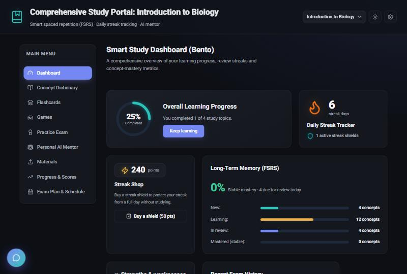
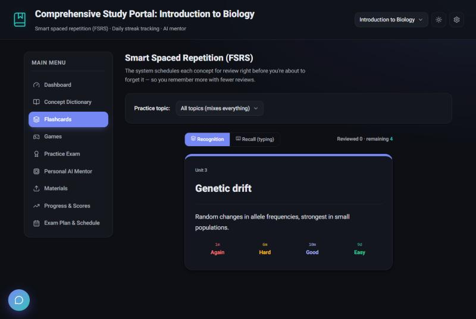
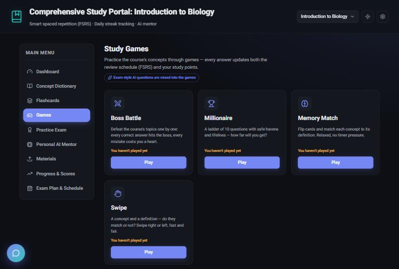
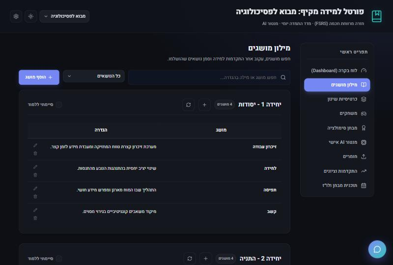

# Tomurized

[](https://github.com/TomLiberman/tomurized/actions/workflows/ci.yml)
[](LICENSE)

**A self-hosted study portal for any course.** Drop in your course files (syllabus, lecture notes,
past exams) and Tomurized builds a complete study set with AI — a concept dictionary, spaced-repetition
flashcards, practice exams, study games and an AI mentor — then schedules your reviews so you
remember more with less work.

> פורטל למידה חכם לכל קורס: מילון מושגים, כרטיסיות שינון בחזרה מרווחת (FSRS), מבחני סימולציה,
> משחקי לימוד ומנטור AI. הממשק תומך בעברית (RTL) ובאנגלית ומזהה את שפת הקורס אוטומטית.

Tomurized runs on your own computer or home server. Your courses and progress stay in a single
SQLite database that you control; the only outside service it talks to is the AI provider you choose
(Google Gemini, with optional OpenAI fallback), using your own API key.

| Dashboard | Flashcards (FSRS) |
| --- | --- |
|  |  |
| **Study games** | **Hebrew course (right-to-left)** |
|  |  |

## Features

- **Course builder** — upload PDF / Word / text files; the AI reads the syllabus, splits the course
  into units and writes flashcards for each one. You review and edit the generated cards before they
  are saved. No AI key? Create an empty course and add cards by hand or import JSON.
- **Spaced repetition (FSRS)** — the modern scheduler used by Anki, with recognition and typed-recall
  modes, confidence ratings, and a calibration view that shows what you *think* you know vs. what you do.
- **Practice exams** — quick multiple-choice from your deck, or AI-written exams that imitate the
  style of your uploaded past exams. Results feed back into the review schedule.
- **AI mentor** — open questions with graded feedback, Feynman mode ("explain it in your own words"),
  Socratic mode, and a course chat that cites the material it used.
- **Study games** — boss battles, a "Millionaire" ladder, memory matching and true/false swiping.
- **Planning** — exam-readiness forecast (predicted recall on exam day), an AI study plan, and
  calendar export (.ics / Google Calendar).
- **Progress** — streaks with streak shields, study points, topic strengths and weaknesses.
- **Works on every device** — data lives on the server, so your phone and laptop stay in sync.
  Installable as a PWA.
- **Hebrew and English** — full RTL support; each course's language is detected automatically.

## Quick start

### With Docker (recommended)

```bash
git clone https://github.com/TomLiberman/tomurized.git
cd tomurized
docker compose up -d
```

Open **http://localhost:8080** (or `http://<server-ip>:8080` from other devices on your network).
Your data is kept in the `tomurized-data` Docker volume.

### With Node.js (24 or newer)

```bash
npm run setup      # installs the web app and server dependencies
npm run build      # builds the web app into dist/
npm start          # serves the app + API on http://localhost:8080
```

Data is stored in `./data` (change it with `DATA_DIR`).

## First steps

1. Open the app and click **Create a new course**.
2. To build a course with AI, paste a **Gemini API key** — get one free at
   [aistudio.google.com/apikey](https://aistudio.google.com/apikey) — then drop in your course files
   (include the syllabus if you have one). Or click **Create an empty course** to start without AI.
3. Review the generated cards, then start studying from the **Flashcards** page.

API keys can be changed anytime from **Settings** (the gear icon). An optional OpenAI key is used as an
automatic fallback when Gemini is overloaded.

## Backups

**Settings → Backup & restore → Download backup** saves every course, card, review history, exam score
and material (as extracted text) into one JSON file. **Restore backup** replaces the server's data with
a backup's contents.

The backup file deliberately leaves out your API keys and the original uploaded files. For a complete
copy, also back up the data directory (`./data`, or the `tomurized-data` Docker volume), which holds the
database and `files/` with the original uploads.

## Security

Tomurized is built for **one person (or a household) on a trusted network**. It has no user accounts
and no login:

- Anyone who can reach the server can read and change all study data, **including the stored AI API
  keys** (the browser needs them, because AI requests are sent from the browser).
- **Do not expose it directly to the internet.** If you want remote access, put it behind a VPN
  (e.g. Tailscale/WireGuard) or a reverse proxy that requires authentication.
- Use API keys with spending limits where your provider supports them.

## Configuration

Environment variables for the server (`npm start` or Docker):

| Variable | Default | Purpose |
| --- | --- | --- |
| `PORT` | `8080` | HTTP port |
| `HOST` | `0.0.0.0` | Interface to listen on (`127.0.0.1` = this computer only) |
| `DATA_DIR` | `./data` (`/data` in Docker) | Database and uploaded files |
| `STATIC_DIR` | `./dist` | Built web app to serve; empty = API only |
| `MAX_UPLOAD_MB` | `100` | Largest single request (file uploads) |
| `MAX_RESTORE_MB` | `1024` | Largest backup file accepted by restore |

## Development

```bash
npm run setup
npm run dev        # API on :8080 (auto-restart) + Vite on :5173 (hot reload)
```

Open http://localhost:5173. Development data goes to `./data`.

| Command | What it does |
| --- | --- |
| `npm test` | Unit tests (Vitest) |
| `npm run lint` | Lint (oxlint) |
| `npm run typecheck` | Type-check the web app and the server |
| `npm run build` | Production build of the web app |

**Stack:** React 19 + Vite + TypeScript, TanStack Query, Tailwind v4 / Base UI, ts-fsrs, pdf.js and
mammoth for text extraction (in the browser). The server is Node 24 running TypeScript directly, with
Hono and the built-in `node:sqlite` — no native modules to compile.

```
src/            web app
  routes/       pages (dashboard, dictionary, flashcards, exam, mentor, materials, progress, plan)
  games/        study games (pure logic is unit-tested)
  data/         FSRS cards, review stats, Hebrew answer matching
  services/     AI prompts and the Gemini/OpenAI client
  i18n/         Hebrew + English strings, language detection
  portal/       app state (usePortalState)
server/src/     API (Hono + SQLite) — also serves the built app in production
```

To add UI text, add the key to both `he` and `en` in `src/i18n/strings.ts` (a missing translation is a
compile error) and use `t('key')`.

## License

[MIT](LICENSE)
